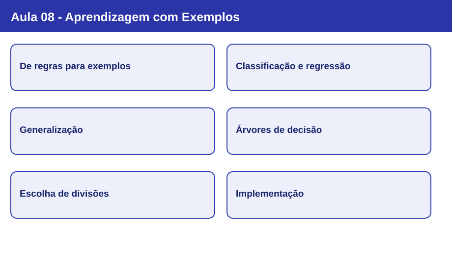
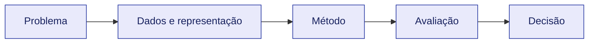

# Nota visual 08 - Aprendizagem com Exemplos

## Mapa conceitual

## Conceitos em sequência

1. **De regras para exemplos:** D={(x_i,y_i)}; hipótese h(x) aproxima relação f(x); desempenho relevante é em exemplos não vistos.
2. **Classificação e regressão:** Classificação prevê classes; regressão prevê valores numéricos contínuos; o alvo define a tarefa.
3. **Generalização:** Underfitting e overfitting; treinamento e teste devem ser separados antes de avaliar.
4. **Árvores de decisão:** Nós são testes, ramos são resultados, folhas são predições; caminho raiz-folha equivale a regra.
5. **Escolha de divisões:** Entropia mede incerteza, Gini mede impureza e ganho de informação compara divisões.
6. **Implementação:** DecisionTreeClassifier, fit, predict, max_depth e representação da árvore.

## Revisão de 30 segundos

O algoritmo é apenas uma parte do processo. A representação dos dados, as hipóteses do classificador e a avaliação condicionam a validade das conclusões.

## Erros conceituais frequentes

- Usar o teste para escolher parâmetros ou transformações.
- Tratar acurácia como critério universal de qualidade.
- Confundir descrição de um algoritmo com garantia de desempenho.

## Revisão de 1 minuto

Explique o objetivo do método, as informações necessárias, uma limitação e como avaliá-lo em dados não observados.

## Checklist

- [ ] Consigo explicar os conceitos centrais sem consultar os slides.
- [ ] Distingo treinamento, validação e teste.
- [ ] Sei apontar a escolha metodológica específica desta aula.
- [ ] Consigo relacionar esta aula às anteriores.

[Estudo guiado](../../estudos-guiados/08-aprendizagem-exemplos/README.md)
