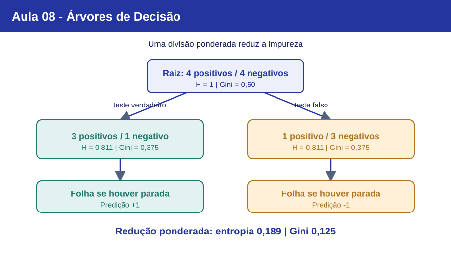
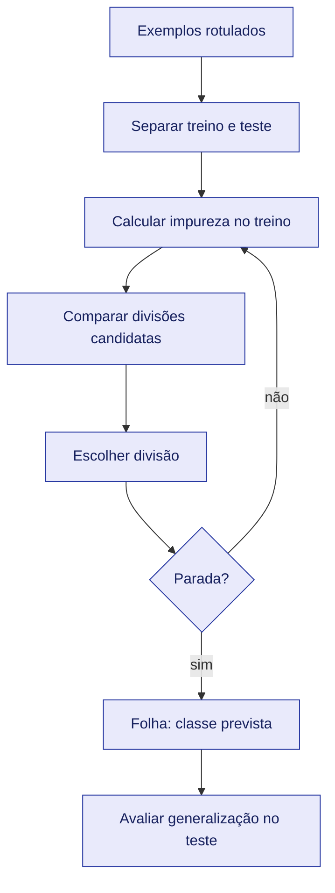

# Nota visual 08 - Aprendizagem com Exemplos



**Questão central:** como transformar exemplos rotulados em uma regra capaz de generalizar?

## Mapa conceitual



## Conceitos em sequência

1. **De regras para exemplos:** D={(x_i,y_i)}; hipótese h(x) aproxima relação f(x); desempenho relevante é em exemplos não vistos.
2. **Classificação e regressão:** Classificação prevê classes; regressão prevê valores numéricos contínuos; o alvo define a tarefa.
3. **Generalização:** Underfitting e overfitting; treinamento e teste devem ser separados antes de avaliar.
4. **Árvores de decisão:** Nós são testes, ramos são resultados, folhas são predições; caminho raiz-folha equivale a regra.
5. **Escolha de divisões:** Entropia mede incerteza, Gini mede impureza e ganho de informação compara divisões.
6. **Implementação:** DecisionTreeClassifier, fit, predict, max_depth e representação da árvore.

## Classificação, regressão e generalização

| Alvo | Tarefa | Exemplo |
|---|---|---|
| Categoria | Classificação | Aprovado ou reprovado |
| Valor numérico | Regressão | Estimar consumo de energia |

Uma hipótese h aprende a partir dos pares (xᵢ,yᵢ). Um modelo simples demais pode não captar padrões (underfitting); um modelo excessivamente ajustado ao treino pode memorizar ruído (overfitting). Dados de validação orientam a escolha de hiperparâmetros, e o teste estima o desempenho final.

## Árvore de decisão: escolher uma divisão

```text
H(S) = -Σ p(c) log₂ p(c)
Gini(S) = 1 - Σ p(c)²
Ganho = I(S) - Σ (|Sⱼ|/|S|) I(Sⱼ)
```

p(c) é a proporção da classe c; I representa a impureza usada. A soma pondera cada filho pelo número de exemplos. Para p(c)=0, considere o termo da entropia igual a zero.

Exemplo didático: oito exemplos, quatro de cada classe. Uma divisão produz um filho com três positivos e um negativo e outro com um positivo e três negativos.

| Conjunto | Positivos / negativos | Entropia | Gini |
|---|---|---:|---:|
| Raiz | 4 / 4 | 1 | 0,5 |
| Filho esquerdo | 3 / 1 | 0,811 | 0,375 |
| Filho direito | 1 / 3 | 0,811 | 0,375 |

O ganho de entropia é 1 - 0,811 = 0,189; a redução de Gini é 0,5 - 0,375 = 0,125. Uma divisão perfeitamente pura teria impureza final zero. O processo é guloso: escolhe a melhor divisão local, não garante a melhor árvore global.

## Da regra ao código

`DecisionTreeClassifier` aprende divisões com `fit`; `predict` percorre a árvore. `max_depth` limita a profundidade, `min_samples_leaf` restringe folhas muito pequenas. Uma árvore profunda pode alcançar ótimo ajuste no treino e desempenho inferior no teste. Em regressão, o critério de divisão e a predição das folhas são numéricos.

## Revisão de 30 segundos

Uma árvore transforma exemplos em testes sucessivos. Cada divisão reduz a impureza segundo um critério local; as folhas fazem predições. A generalização depende da complexidade e do protocolo de avaliação.

## Erros conceituais frequentes

- Usar o teste para escolher parâmetros ou transformações.
- Tratar acurácia como critério universal de qualidade.
- Confundir ganho de informação com impureza do filho.
- Considerar uma árvore profunda necessariamente melhor.

## Revisão de 1 minuto

Calcule a impureza da raiz de duas classes equilibradas, explique o ganho ponderado e descreva como uma nova amostra chega à folha.

## Checklist

- [ ] Distingo classificação e regressão.
- [ ] Distingo treinamento, validação e teste.
- [ ] Calculo entropia, Gini e redução ponderada.
- [ ] Interpreto uma regra raiz-folha e efeitos de profundidade.

[Estudo guiado](../../estudos-guiados/08-aprendizagem-exemplos/README.md)

**Próxima conexão:** KNN usa a proximidade dos exemplos em vez de aprender uma árvore de testes.
