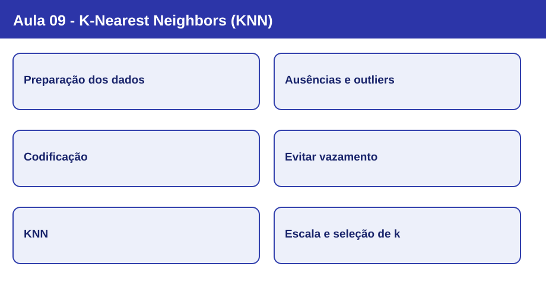
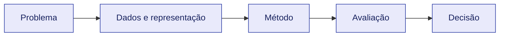

# Nota visual 09 - K-Nearest Neighbors (KNN)

## Mapa conceitual

## Conceitos em sequência

1. **Preparação dos dados:** Titanic train.csv; atributos Pclass, Sex, Age, SibSp, Parch, Fare e Embarked; alvo Survived.
2. **Ausências e outliers:** Imputação de mediana/moda segundo a coluna; outlier não é automaticamente erro.
3. **Codificação:** OneHotEncoder para categorias nominais; ColumnTransformer e Pipeline evitam inconsistências.
4. **Evitar vazamento:** Treino/teste antes de aprender mediana, escala e parâmetros da transformação.
5. **KNN:** Distância aos exemplos de treino, ordenação, k vizinhos e voto majoritário.
6. **Escala e seleção de k:** StandardScaler e validação cruzada k-fold; escolher k sem consultar conjunto de teste.

## Revisão de 30 segundos

O algoritmo é apenas uma parte do processo. A representação dos dados, as hipóteses do classificador e a avaliação condicionam a validade das conclusões.

## Erros conceituais frequentes

- Usar o teste para escolher parâmetros ou transformações.
- Tratar acurácia como critério universal de qualidade.
- Confundir descrição de um algoritmo com garantia de desempenho.

## Revisão de 1 minuto

Explique o objetivo do método, as informações necessárias, uma limitação e como avaliá-lo em dados não observados.

## Checklist

- [ ] Consigo explicar os conceitos centrais sem consultar os slides.
- [ ] Distingo treinamento, validação e teste.
- [ ] Sei apontar a escolha metodológica específica desta aula.
- [ ] Consigo relacionar esta aula às anteriores.

[Estudo guiado](../../estudos-guiados/09-knn/README.md)
