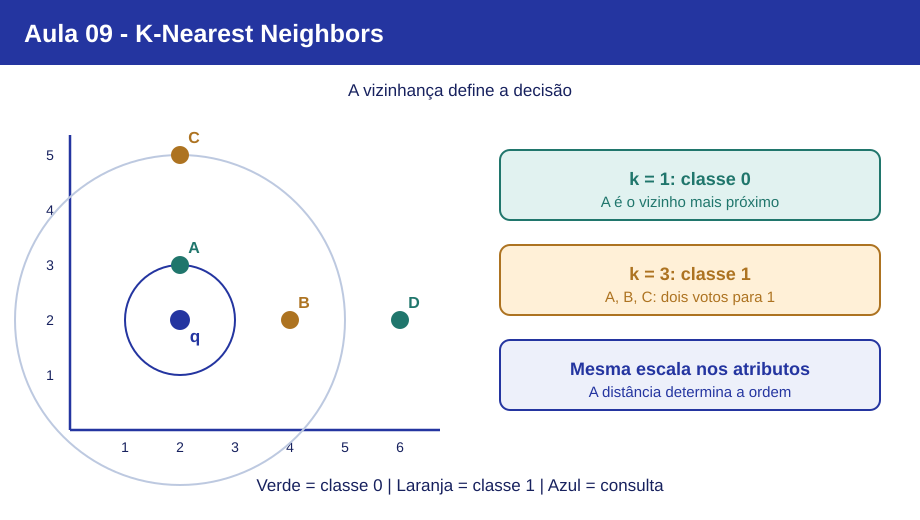
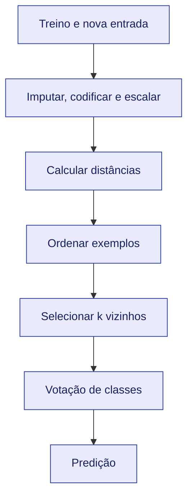

# Nota visual 09 - K-Nearest Neighbors (KNN)



**Questão central:** quais exemplos são semelhantes e como a representação muda essa decisão?

## Mapa conceitual



## Conceitos em sequência

1. **Preparação dos dados:** Titanic train.csv; atributos Pclass, Sex, Age, SibSp, Parch, Fare e Embarked; alvo Survived.
2. **Ausências e outliers:** Imputação de mediana/moda segundo a coluna; outlier não é automaticamente erro.
3. **Codificação:** OneHotEncoder para categorias nominais; ColumnTransformer e Pipeline evitam inconsistências.
4. **Evitar vazamento:** Treino/teste antes de aprender mediana, escala e parâmetros da transformação.
5. **KNN:** Distância aos exemplos de treino, ordenação, k vizinhos e voto majoritário.
6. **Escala e seleção de k:** StandardScaler e validação cruzada k-fold; escolher k sem consultar conjunto de teste.

## Distância e escolha de k

```text
d(x,z) = sqrt(Σ (xⱼ - zⱼ)²)
```

x e z são vetores de atributos e j percorre suas dimensões. Com consulta q=(2,2), os exemplos abaixo produzem:

| Exemplo | Coordenadas | Classe | Distância a q |
|---|---|---|---:|
| A | (2,3) | 0 | 1 |
| B | (4,2) | 1 | 2 |
| C | (2,5) | 1 | 3 |
| D | (6,2) | 0 | 4 |

k=1 prevê 0; k=3 prevê 1 por maioria. A escolha de k altera a suavidade da fronteira: valores pequenos são sensíveis a ruído, valores grandes podem apagar estruturas locais. Em regressão, agrega-se o valor dos vizinhos, não seus rótulos.

## Por que preparar os atributos?

Se idade variar 10 unidades e tarifa variar 100, a segunda diferença domina a distância euclidiana bruta, mesmo que isso seja apenas efeito de escala. Para uma variável numérica, padronize usando z=(x-μ)/σ, com μ e σ estimados no treino. Categorias nominais exigem codificação apropriada, não uma ordem numérica arbitrária.

| Atributo no Titanic | Preparação |
|---|---|
| Age, Fare | Imputação e padronização conforme estratégia |
| Pclass, SibSp, Parch | Considerar significado ordinal/numérico |
| Sex, Embarked | Codificação de categorias e tratamento de ausências |
| Survived | Alvo, não atributo de entrada |

## Validação cruzada

Para testar k=1,3,5 (ou outros valores), compare as médias das métricas sobre os mesmos folds do treino. Em cada fold, a imputação, codificação e escala são ajustadas somente à parte de treinamento. `Pipeline` e `ColumnTransformer` mantêm esse isolamento. Escolha k pelo desempenho de validação, não pelo teste; o teste reservado só avalia a configuração final.

## Revisão de 30 segundos

KNN armazena exemplos e decide por proximidade. Escala, codificação, métrica de distância e k determinam quais vizinhos influenciam a predição.

## Erros conceituais frequentes

- Usar o teste para escolher parâmetros ou transformações.
- Tratar acurácia como critério universal de qualidade.
- Escolher k observando o teste ou padronizar antes de separar os dados.
- Supor que distância pequena garante classe correta.

## Revisão de 1 minuto

Ordene os quatro vizinhos do exemplo, compare k=1 e k=3 e explique como multiplicar uma dimensão por 100 pode alterar a ordem.

## Checklist

- [ ] Calculo distância e voto de vizinhos.
- [ ] Distingo treinamento, validação e teste.
- [ ] Identifico transformações numéricas e categóricas.
- [ ] Escolho k por validação cruzada sem vazamento.

[Estudo guiado](../../estudos-guiados/09-knn/README.md)

**Próxima conexão:** SVM aprende uma fronteira de decisão, em vez de consultar vizinhos a cada predição.
