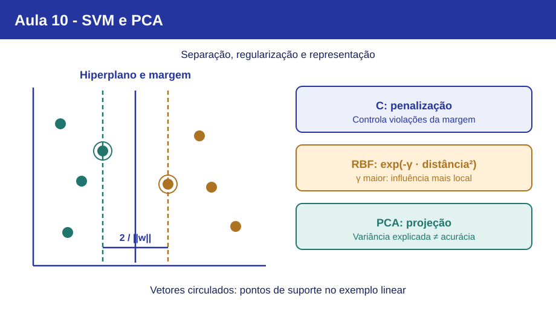
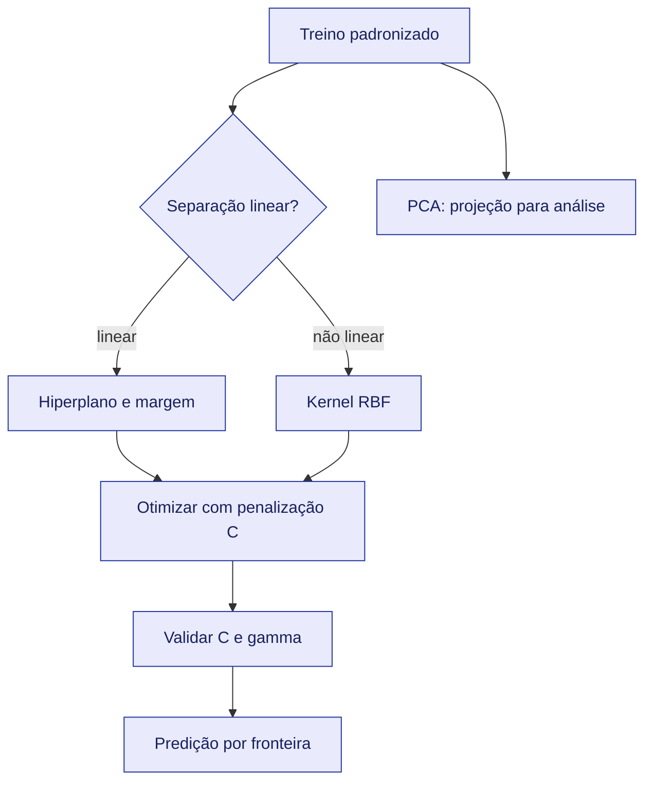

# Nota visual 10 - Support Vector Machines e PCA



**Questão central:** como definir uma fronteira que separe classes e generalize para novos exemplos?

## Mapa conceitual



## Conceitos em sequência

1. **Hiperplano e margem:** SVM procura fronteira de decisão de grande margem; vetores de suporte influenciam sua posição.
2. **Soft margin e C:** C menor implica maior regularização; C maior penaliza mais violações de margem.
3. **Separação não linear:** Mudança de representação e kernel trick; visualização 2D para 3D como apoio conceitual.
4. **RBF/Gaussiana:** K(x,z)=exp(-gamma ||x-z||²); gamma menor amplia influência; gamma maior torna influência local.
5. **Experimento:** Pipeline com StandardScaler e SVC linear/RBF; validação para escolha de parâmetros.
6. **PCA:** Redução de dimensionalidade para visualização; explained_variance_ratio_ indica fração de variância explicada por componente.

## Margem e vetores de suporte

```text
f(x) = wᵀx + b
classe = sign(f(x))
margem total = 2 / ||w||
```

Na formulação canônica do SVM linear, w define a orientação do hiperplano e b o deslocamento. As superfícies f(x)=±1 delimitam a margem. Vetores de suporte são os exemplos que influenciam a solução. Soft margin admite violações, penalizadas pelo hiperparâmetro C.

| Parâmetro | Valor menor | Valor maior |
|---|---|---|
| C | Maior regularização relativa; tolera mais violações | Penaliza mais violações; pode ajustar ruído |
| gamma (RBF) | Influência mais ampla | Influência mais localizada |

## Kernel RBF: similaridade pela distância

```text
K(x,z) = exp(-γ ||x-z||²)
```

Se a distância quadrática é 4, com γ=0,25 obtemos exp(-1)≈0,368; com γ=1, exp(-4)≈0,018. O kernel influencia a geometria da fronteira; gamma não é uma taxa de aprendizagem. C e gamma devem ser escolhidos conjuntamente por validação. O kernel trick calcula produtos internos no espaço de características sem construir explicitamente todas as coordenadas.

## PCA: projetar não é classificar

PCA encontra direções ortogonais de maior variância. Após centralizar os dados, uma projeção em k componentes usa Z=(X-μ)Vₖ, onde Vₖ contém as direções escolhidas. Se as duas primeiras componentes explicam 0,60 e 0,25 da variância, sua soma é 0,85. Isso não significa 85% de acurácia nem garante separação das classes.

PCA pode apoiar uma visualização 2D sem ser usado pelo classificador. Se fizer parte do pipeline, ajuste escala e PCA apenas no treino de cada fold. A visualização de uma fronteira em duas componentes não é necessariamente a fronteira do modelo treinado com todos os atributos.

## Revisão de 30 segundos

SVM procura uma fronteira regularizada de grande margem; RBF permite relações não lineares. PCA projeta dados em direções de maior variância e não é um classificador.

## Erros conceituais frequentes

- Usar o teste para escolher parâmetros ou transformações.
- Tratar acurácia como critério universal de qualidade.
- Confundir gamma com C ou com taxa de aprendizagem.
- Interpretar variância explicada pelo PCA como acurácia.

## Revisão de 1 minuto

Identifique hiperplano, margem e vetores de suporte; explique como C e gamma alteram a fronteira e por que PCA não garante separação.

## Checklist

- [ ] Identifico hiperplano, margem e vetores de suporte.
- [ ] Distingo treinamento, validação e teste.
- [ ] Interpreto C, gamma e o kernel RBF.
- [ ] Distingo projeção PCA de classificação.

[Estudo guiado](../../estudos-guiados/10-svm/README.md)

**Próxima conexão:** comparar DT, KNN e SVM exige o mesmo protocolo experimental e métricas.
