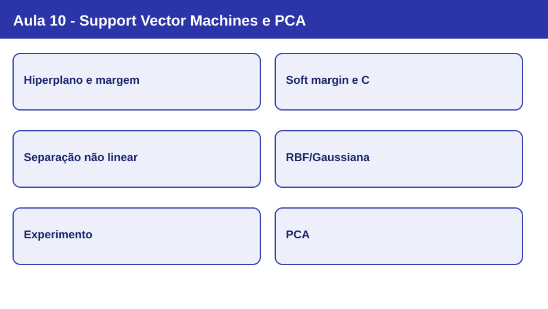
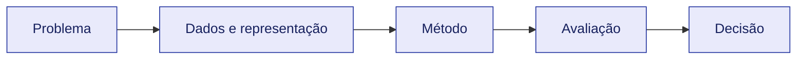

# Nota visual 10 - Support Vector Machines e PCA

## Mapa conceitual

## Conceitos em sequência

1. **Hiperplano e margem:** SVM procura fronteira de decisão de grande margem; vetores de suporte influenciam sua posição.
2. **Soft margin e C:** C menor implica maior regularização; C maior penaliza mais violações de margem.
3. **Separação não linear:** Mudança de representação e kernel trick; visualização 2D para 3D como apoio conceitual.
4. **RBF/Gaussiana:** K(x,z)=exp(-gamma ||x-z||²); gamma menor amplia influência; gamma maior torna influência local.
5. **Experimento:** Pipeline com StandardScaler e SVC linear/RBF; validação para escolha de parâmetros.
6. **PCA:** Redução de dimensionalidade para visualização; explained_variance_ratio_ indica fração de variância explicada por componente.

## Revisão de 30 segundos

O algoritmo é apenas uma parte do processo. A representação dos dados, as hipóteses do classificador e a avaliação condicionam a validade das conclusões.

## Erros conceituais frequentes

- Usar o teste para escolher parâmetros ou transformações.
- Tratar acurácia como critério universal de qualidade.
- Confundir descrição de um algoritmo com garantia de desempenho.

## Revisão de 1 minuto

Explique o objetivo do método, as informações necessárias, uma limitação e como avaliá-lo em dados não observados.

## Checklist

- [ ] Consigo explicar os conceitos centrais sem consultar os slides.
- [ ] Distingo treinamento, validação e teste.
- [ ] Sei apontar a escolha metodológica específica desta aula.
- [ ] Consigo relacionar esta aula às anteriores.

[Estudo guiado](../../estudos-guiados/10-svm/README.md)
