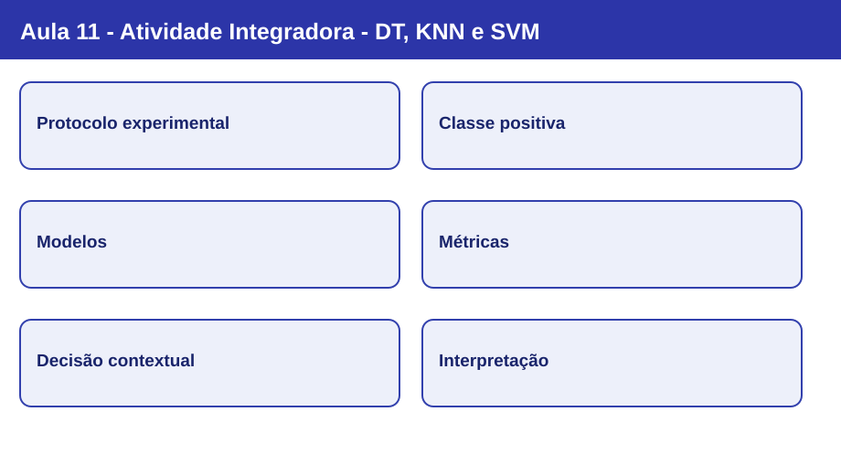
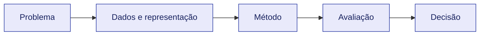

# Nota visual 11 - Atividade Integradora - DT, KNN e SVM

## Mapa conceitual

## Conceitos em sequência

1. **Protocolo experimental:** Mesma base, alvo, divisão, semente e métricas; sem tuning no teste.
2. **Classe positiva:** Na base Breast Cancer do scikit-learn: original 0=malignant; transformar para 1=maligno como classe positiva.
3. **Modelos:** DT max_depth=4, KNN k=5 e SVM RBF com C=1 e gamma=scale.
4. **Métricas:** Acurácia, precisão, recall e F1; matriz de confusão [[TN,FP],[FN,TP]].
5. **Decisão contextual:** Falsos negativos podem custar mais que falsos positivos; métricas são complementares.
6. **Interpretação:** Resultados de uma única partição e uma base não estabelecem superioridade universal.

## Revisão de 30 segundos

O algoritmo é apenas uma parte do processo. A representação dos dados, as hipóteses do classificador e a avaliação condicionam a validade das conclusões.

## Erros conceituais frequentes

- Usar o teste para escolher parâmetros ou transformações.
- Tratar acurácia como critério universal de qualidade.
- Confundir descrição de um algoritmo com garantia de desempenho.

## Revisão de 1 minuto

Explique o objetivo do método, as informações necessárias, uma limitação e como avaliá-lo em dados não observados.

## Checklist

- [ ] Consigo explicar os conceitos centrais sem consultar os slides.
- [ ] Distingo treinamento, validação e teste.
- [ ] Sei apontar a escolha metodológica específica desta aula.
- [ ] Consigo relacionar esta aula às anteriores.

[Estudo guiado](../../estudos-guiados/11-atividade-comparacao/README.md)
