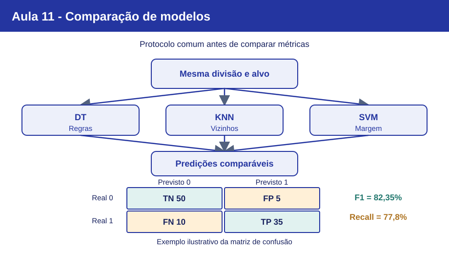
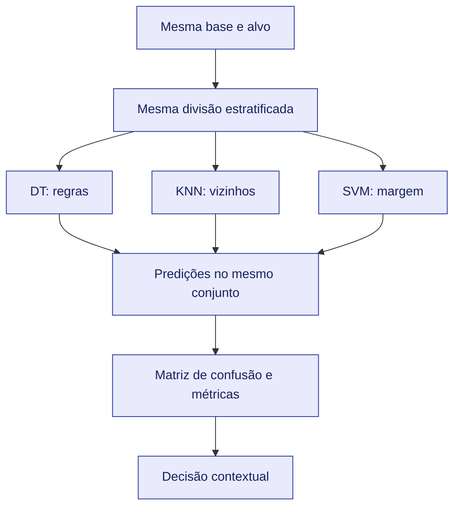

# Nota visual 11 - Atividade Integradora - DT, KNN e SVM

**Questão central:** que evidência permite comparar modelos sem confundir qualidade e condições de avaliação?

## Mapa conceitual

## Conceitos em sequência

1. **Protocolo experimental:** Mesma base, alvo, divisão, semente e métricas; sem tuning no teste.
2. **Classe positiva:** Na base Breast Cancer do scikit-learn: original 0=malignant; transformar para 1=maligno como classe positiva.
3. **Modelos:** DT max_depth=4, KNN k=5 e SVM RBF com C=1 e gamma=scale.
4. **Métricas:** Acurácia, precisão, recall e F1; matriz de confusão [[TN,FP],[FN,TP]].
5. **Decisão contextual:** Falsos negativos podem custar mais que falsos positivos; métricas são complementares.
6. **Interpretação:** Resultados de uma única partição e uma base não estabelecem superioridade universal.

## Matriz de confusão: exemplo ilustrativo

Considere a classe positiva como maligno, conforme a atividade. Com linhas referentes às classes reais e colunas às previstas:

| Real / previsto | Negativo | Positivo |
|---|---:|---:|
| Negativo | TN = 50 | FP = 5 |
| Positivo | FN = 10 | TP = 35 |

| Métrica | Expressão | Resultado |
|---|---|---:|
| Acurácia | (TP+TN)/(TP+TN+FP+FN) | 85% |
| Precisão | TP/(TP+FP) | 87,5% |
| Recall | TP/(TP+FN) | 77,8% |
| F1 | 2·TP/(2·TP+FP+FN) | 82,35% |

Precisão responde quantas predições positivas estavam certas; recall responde quantos positivos reais foram detectados. F1 é a média harmônica de precisão e recall. A métrica adequada depende da classe de interesse e do custo dos erros. Em uma tarefa de triagem, falsos negativos podem ter consequências mais graves; esse exemplo não estabelece utilidade clínica.

## Comparação justa

| Modelo | Informação usada | Sensibilidade |
|---|---|---|
| DT | Divisões por impureza | Profundidade, variância |
| KNN | Distâncias e vizinhos | Escala, k, dimensionalidade |
| SVM | Margem e kernel | Escala, C e gamma |

Use a mesma divisão e a mesma classe positiva; mantenha transformações compatíveis com cada estimador e ajustadas somente no treino. Uma única divisão é uma demonstração; validação cruzada no treino com folds comuns permite investigar média e dispersão. Reserve o teste para avaliação final, sem seleção de parâmetros por ele.

## Revisão de 30 segundos

Modelos só são comparáveis sob critérios comuns. Leia a matriz de confusão, interprete precisão e recall para a classe positiva e considere dispersão e custo.

## Erros conceituais frequentes

- Usar o teste para escolher parâmetros ou transformações.
- Tratar acurácia como critério universal de qualidade.
- Inverter a interpretação de falsos positivos e negativos.
- Comparar métricas calculadas com classes positivas diferentes.

## Revisão de 1 minuto

Calcule precisão e recall a partir da matriz e explique por que a escolha de modelo depende da consequência dos erros, não apenas da acurácia.

## Checklist

- [ ] Interpreto TN, FP, FN e TP.
- [ ] Distingo treinamento, validação e teste.
- [ ] Calculo acurácia, precisão, recall e F1.
- [ ] Justifico comparação com divisões e métricas comuns.

[Estudo guiado](../../estudos-guiados/11-atividade-comparacao/README.md)

**Próxima conexão:** a comparação de modelos prepara o Trabalho 02 e a investigação de ensembles na Aula 15.
