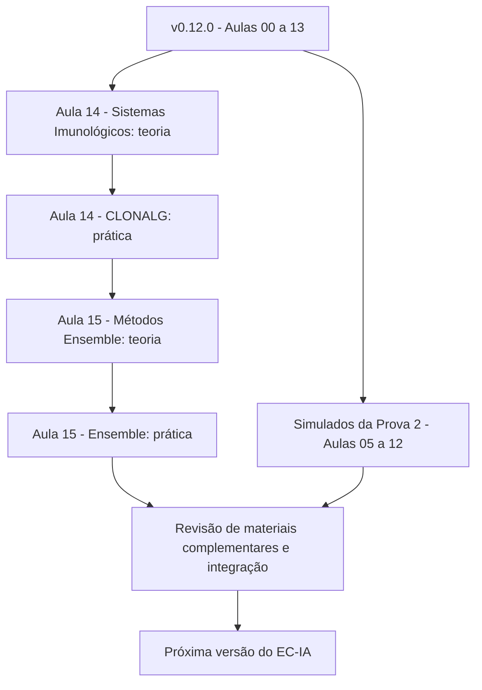

# Roadmap de desenvolvimento do EC-IA

O roadmap apresenta os próximos materiais planejados para a disciplina. **Planejado** não significa publicado. Os marcos podem ser ajustados conforme o andamento das aulas e a revisão pedagógica.

## Marco consolidado - v0.12.0

**Concluído:** materiais públicos das Aulas 00 a 13; teoria e prática de Algoritmos Genéticos e Inteligência de Enxames; notas visuais, estudos guiados e pseudocódigos; laboratórios interativos de DT, KNN, SVM, AG, ACO e BPSO; organização dos simulados por avaliação.

A publicação dos materiais já consolidados pode ser consultada nas [aulas](aulas/index.md) e nas [visualizações](visualizacoes/index.md).

## Próximas etapas

| Etapa | Escopo | Situação | Critério para concluir |
|---|---|---|---|
| Aula 14 - Teoria | Sistemas Imunológicos Artificiais: inspiração biológica, seleção clonal, CLONALG, hipermutação e diversidade | Planejada | PDF teórico revisado e articulado com AG/ACO/PSO |
| Aula 14 - Prática | Implementação e análise experimental de CLONALG no mesmo problema de otimização usado para comparação | Planejada | PDF prático e código-base testados, com sementes e resultados interpretáveis |
| Aula 15 - Teoria | Métodos Ensemble: Bagging, Random Forest, Boosting e AdaBoost; relação com DT, KNN e SVM | Planejada | PDF teórico com conceitos, exemplos e comparações |
| Aula 15 - Prática | Experimentos reprodutíveis de classificação e comparação de modelos individuais e ensembles | Planejada | PDF prático, exemplos Python e análise de métricas |
| Simulados - Prova 2 | Revisão integrada das Aulas **05 a 12**, conforme o escopo definido para a avaliação | A disponibilizar | Enunciados revisados e publicados na [seção de simulados](simulados/index.md) |
| Materiais complementares | Notas visuais, estudos guiados, pseudocódigos e visualizações das Aulas 14 e 15, quando pertinentes | Planejados | Material integrado ao site, com navegação revisada |
| Consolidação | Revisão dos links, acessibilidade, exercícios, exemplos e build estrito antes de nova versão | Planejada | PR aprovado, CI/deployment validado e changelog atualizado |

## Sequência pedagógica

As etapas de simulados e materiais complementares podem avançar em paralelo às aulas, sem alterar o escopo definido para a Prova 2.

## Diretrizes de publicação

- Preservar a identidade visual e o padrão de teoria/prática aprovado nas Aulas 12 e 13.
- Utilizar exemplos articulados ao Trabalho 02, mantendo a mesma formulação quando o objetivo for comparar métodos.
- Separar materiais públicos das soluções de referência, gabaritos e fontes restritas.
- Manter código com indentação de dois espaços por nível e sementes explícitas nos experimentos.
- Desenvolver em branches, revisar por Pull Request e atualizar documentação e changelog antes de criar tag e Release.
- Não atribuir datas nem status de publicação antes da efetiva disponibilização.

Este roadmap informa a evolução planejada do repositório e não substitui o cronograma oficial da disciplina.
