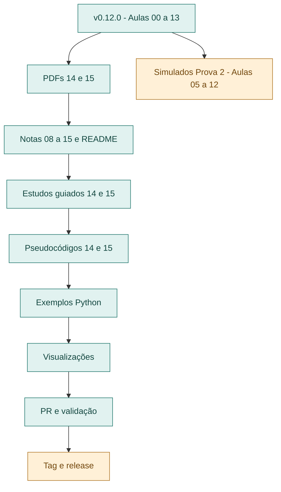

# Roadmap de desenvolvimento do EC-IA

O roadmap apresenta os próximos materiais planejados para a disciplina. **Planejado** não significa publicado. Os marcos podem ser ajustados conforme o andamento das aulas e a revisão pedagógica.

## Marco consolidado - v0.12.0

**Concluído:** materiais públicos das Aulas 00 a 13; teoria e prática de Algoritmos Genéticos e Inteligência de Enxames; notas visuais, estudos guiados e pseudocódigos; laboratórios interativos de DT, KNN, SVM, AG, ACO e BPSO; organização dos simulados por avaliação.

A publicação dos materiais já consolidados pode ser consultada nas [aulas](aulas/index.md) e nas [visualizações](visualizacoes/index.md).

## Atualização das Aulas 14 e 15

Os PDFs de teoria e prática e os materiais complementares foram integrados à branch principal. A refatoração do build também foi integrada.

| Recurso | Aula 14 - Sistemas Imunológicos | Aula 15 - Ensemble |
|---|---|---|
| Teoria e prática | Integrados à main | Integrados à main |
| Notas visuais | Integradas à atualização | Integradas à atualização |
| Estudos guiados | Integrados à atualização | Integrados à atualização |
| Pseudocódigos | Integrados à atualização | Integrados à atualização |
| Visualizações | Integradas à atualização | Integradas à atualização |
| Exemplos Python | Integrados e testados | Integrados e testados |

Os recursos das Aulas 14 e 15 foram integrados à main. A disponibilização dos três simulados da Prova 2 depende da revisão e integração da atualização independente.

## Revisões e próximas etapas

| Etapa | Situação | Escopo e critério de conclusão |
|---|---|---|
| Notas 08 a 11 | Integradas à atualização | Diagramas específicos de DT, KNN, SVM/PCA e comparação; exemplos numéricos e revisão ativa |
| Notas 12 e 13 | Integradas à atualização | Refinamento dos diagramas de AG, ACO e BPSO, preservando os conceitos e exemplos |
| README principal | Integrado à atualização | Catálogo completo, percurso didático e disponibilidade dos recursos |
| Visualizações 14 e 15 | Integradas à atualização | NSA, CLONALG e mecanismos ensemble com parâmetros, estados e decisões interpretáveis; comparação integrada de AG, ACO, BPSO e CLONALG com orçamento comum |
| Exemplos Python 14 e 15 | Integrados à atualização | Códigos das práticas, instruções de execução, dependências, sementes e testes |
| Simulados - Prova 2 | Preparados para revisão | Três simulados das Aulas **05 a 12**, com oito questões cada e enunciados sem gabaritos |
| Padronização documental | Integrada à atualização | Documentação principal, página inicial e sincronização das cópias utilizadas pelo MkDocs |
| Consolidação das Aulas 14 e 15 | Integrada à main | Revisão de links, exemplos, build estrito e PR |
| Tag e release | Planejadas | Publicação da versão após consolidação na main e revisão do changelog |

## Qualidade das notas visuais

A revisão das notas das Aulas 08 a 13 foi uma etapa de **aprimoramento** dos materiais já publicados, sem alteração automática dos slides ou das avaliações.

1. **Aulas 08 a 11:** substituir fluxogramas genéricos por representações específicas dos algoritmos e aprofundar o raciocínio de cada método.
2. **Aulas 12 e 13:** preservar o conteúdo técnico e os exemplos resolvidos, aprimorando a comunicação visual e a relação entre os mecanismos.
3. **Aulas 14 e 15:** utilizar o padrão revisado como referência para novas notas, mantendo continuidade com as anteriores.

Critérios de revisão: pergunta central, mapa conceitual próprio, exemplos progressivos com decisões justificadas, fórmulas quando pertinentes, relação com implementação, limitações, perguntas de interpretação, síntese e conexão com a aula seguinte. A revisão deve verificar legibilidade, acessibilidade e coerência com os materiais canônicos aprovados.

## Sequência de integração

Verde indica etapas integradas; amarelo indica etapas pendentes. Os simulados seguem uma trilha independente, sem alterar o escopo definido para a Prova 2.

## Diretrizes de publicação

- Preservar a identidade visual e o padrão de teoria/prática aprovado nas Aulas 12 e 13.
- Utilizar exemplos articulados ao Trabalho 02, mantendo a mesma formulação quando o objetivo for comparar métodos.
- Separar materiais públicos das soluções de referência, gabaritos e fontes restritas.
- Manter código com indentação de dois espaços por nível e sementes explícitas nos experimentos.
- Desenvolver em branches, revisar por Pull Request e atualizar documentação e changelog antes de criar tag e Release.
- Não atribuir datas nem status de publicação antes da efetiva disponibilização.

Este roadmap informa a evolução planejada do repositório e não substitui o cronograma oficial da disciplina.
