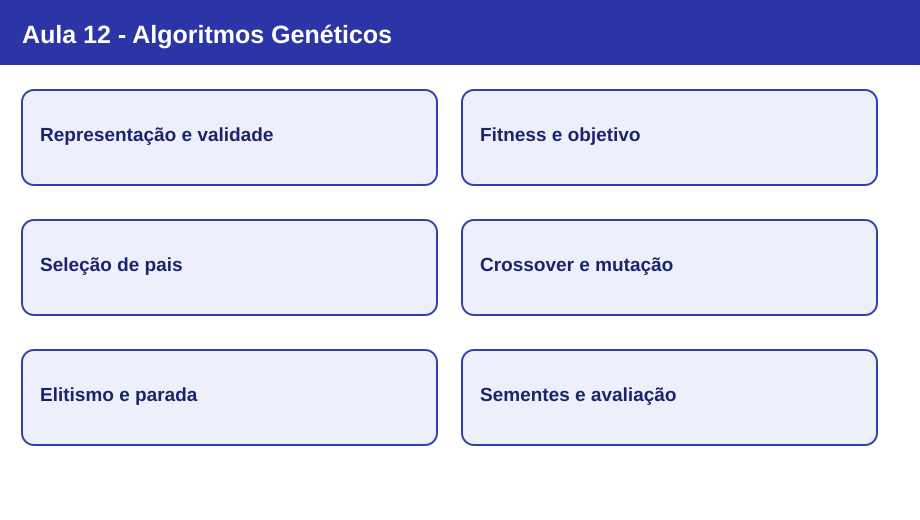

# Nota visual 12 - Algoritmos Genéticos



## Mapa conceitual

```mermaid
flowchart LR
  A["Problema e restrições"] --> B["Representação dos indivíduos"]
  B --> C["População inicial"]
  C --> D["Avaliação por fitness"]
  D --> E["Seleção de pais"]
  E --> F["Crossover e mutação"]
  F --> G["Nova geração e elitismo"]
  G --> D
  D --> H{"Critério de parada?"}
  H -->|sim| I["Melhor solução conhecida"]
  H -->|não| E
  classDef base fill:#e9eafb,stroke:#2435a0,color:#17215e;
  classDef action fill:#e1f2f0,stroke:#20766c,color:#12463f;
  classDef end fill:#e8f5e9,stroke:#2c7a40,color:#154923;
  class A,B,C,D,H base;
  class E,F,G action;
  class I end;
```

## Conceitos em sequência

1. **Da busca local à busca populacional:** em vez de modificar somente uma solução corrente, o AG mantém uma população de candidatos. Isso amplia as possibilidades de exploração, mas não elimina a convergência prematura.
2. **Representação e validade:** um cromossomo codifica uma solução; genes representam componentes. Codificações binárias, reais e por permutação exigem operadores compatíveis com suas restrições.
3. **Função objetivo e fitness:** a função objetivo expressa o problema; a aptidão estabelece como comparar candidatos no mecanismo de seleção. Em minimização, não se deve tratar automaticamente um custo maior como uma aptidão melhor.
4. **Seleção:** roleta amostra pais conforme aptidões não negativas normalizadas; torneio escolhe o melhor entre participantes sorteados. Selecionar não é garantir o melhor indivíduo global.
5. **Crossover e mutação:** recombinação de um ou mais pontos e mutação por gene introduzem variações. Um descendente pode melhorar, piorar ou manter a aptidão; a codificação determina o operador apropriado.
6. **Elitismo, parada e experimentação:** preservar a elite evita perder o melhor candidato conhecido. Sementes, parâmetros, tamanho da população e orçamento de avaliações influenciam os resultados; uma execução não demonstra superioridade.

## Mapa de decisões: representação e operadores

| Representação | Exemplo de candidato | Atenção ao operador |
|---|---|---|
| Binária | `0110 1001 1001 0110` | Crossover de um ponto e inversão de bits mantêm a codificação binária. |
| Real | `[0.2, -1.7, 3.0]` | Respeitar limites e significado das variáveis. |
| Permutação | `[A, C, B, D]` | Crossover binário direto pode repetir cidades e omitir outras; exigir operador específico ou reparação. |

## O ciclo de AG na prática: imagem 4 × 4

O alvo da prática é `0110 / 1001 / 1001 / 0110`, com **16 genes binários**. Cada bit vale 0 (branco) ou 1 (preto), e o fitness conta coincidências com o alvo:

```text
Alvo            Candidato
0110            0110
1001            1010
1001            1001
0110            0110
```

Esse candidato difere em duas posições e obtém **fitness 14/16**. A seleção por torneio, o crossover de um ponto, a mutação por bit e o elitismo atuam sobre esse mesmo objetivo didático. Não se trata de um problema que necessite de AG para obter solução exata: o interesse é observar seus mecanismos.

## Da imagem ao TSP

No TSP, um cromossomo codifica uma **permutação** de cidades e a função objetivo minimiza o custo do circuito. A estrutura do problema muda, portanto os operadores usados na imagem binária não devem ser transferidos sem adaptação. A etapa fundamental continua sendo escolher representação, função objetivo, restrições e operadores coerentes.

## Revisão de 30 segundos

AG evolui uma população de soluções candidatas. A avaliação atribui qualidade; a seleção favorece pais; crossover e mutação criam descendentes; elitismo preserva bons candidatos. A representação e as restrições condicionam todos esses mecanismos.

## Erros conceituais frequentes

- Afirmar que populações garantem o ótimo global ou eliminam estagnação.
- Confundir **maximização de fitness** com **minimização do custo original** sem transformação apropriada.
- Tratar crossover e mutação como operadores que necessariamente melhoram a solução.
- Usar crossover de bits em permutações do TSP sem garantir visitas válidas.
- Concluir que um parâmetro é melhor a partir de uma única execução.

## Revisão de 1 minuto

Explique por que a escolha do cromossomo precede a escolha do crossover. Depois descreva uma geração completa e justifique por que, na imagem 4 × 4, o melhor fitness deve ser avaliado com o mesmo alvo e múltiplas sementes ao comparar configurações.

## Checklist

- [ ] Distingo solução, cromossomo, gene, população e geração.
- [ ] Sei relacionar objetivo, custo e fitness.
- [ ] Consigo executar seleção por torneio e interpretar seleção por roleta.
- [ ] Sei mostrar crossover, mutação por bit e elitismo em um exemplo binário.
- [ ] Identifico quando uma representação exige operadores específicos.
- [ ] Reconheço os limites de conclusões baseadas em uma única execução.
- [ ] Consigo explicar como a Aula 13 compartilha informação sem crossover.

[Slides da Aula 12](../../aulas/12-algoritmos-geneticos/README.md) · [Exemplo Python pós-aula](../../exemplos/12-algoritmos-geneticos/README.md)

**Próxima conexão:** ACO e PSO também utilizam múltiplos candidatos, mas orientam a busca por feromônios ou memórias individuais e coletivas, não pela mesma sequência de operadores genéticos.
