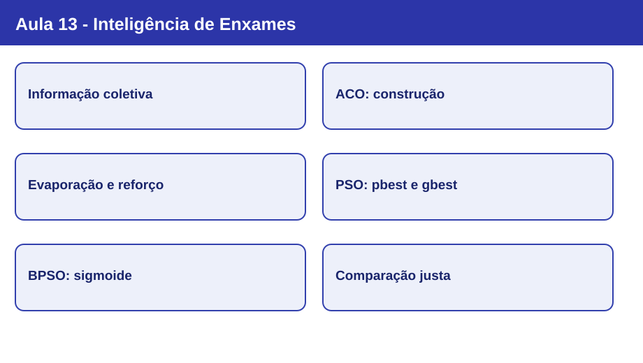
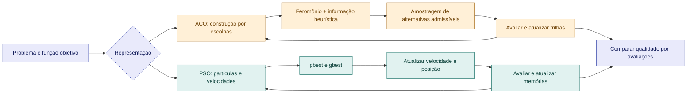

# Nota visual 13 - Inteligência de Enxames



## Mapa conceitual



## Conceitos em sequência

1. **Inteligência coletiva:** regras locais e troca explícita ou implícita de informações podem produzir comportamento global coordenado. Inspiração biológica não é reprodução fiel da natureza nem garantia de ótimo.
2. **ACO:** cada formiga constrói uma solução; feromônios registram experiência coletiva. No TSP, as escolhas incidem sobre cidades ainda admissíveis e podem usar informação heurística de distância.
3. **Transição probabilística:** a chance de escolher uma aresta admissível é proporcional a `τ^α η^β`. Feromônio e heurística têm influências distintas; a próxima cidade é **amostrada**, não necessariamente a mais provável.
4. **Evaporação e reforço:** o Ant System reduz todas as trilhas por `(1 − ρ)` e deposita `Q/L` nas utilizadas pelas formigas. Evaporação e reforço ajustam a memória coletiva; não impedem sozinhos estagnação.
5. **PSO:** partículas têm posições e velocidades; a atualização combina inércia, atração pelo melhor individual (`pbest`) e pelo melhor coletivo (`gbest`). O PSO clássico opera naturalmente com variáveis contínuas.
6. **Adaptação binária e avaliação:** para a imagem de 16 bits, ACO usa feromônios para duas escolhas por bit e BPSO transforma velocidades reais em probabilidades por sigmoide. A comparação exige o mesmo alvo, a mesma função objetivo e orçamento equivalente de avaliações.

## ACO no TSP: regra de decisão

Com `η_ij = 1/d_ij` para distâncias positivas e conjunto de cidades admissíveis `N_i`, a probabilidade de transição é:

```text
P(i → j) = [τ_ij^α · η_ij^β] / Σ[k em N_i] [τ_ik^α · η_ik^β]
```

No exemplo da aula, os pesos são 0,25 (B), 0,125 (C) e 0,04 (D); a soma é 0,415. As probabilidades são aproximadamente **60,24%**, **30,12%** e **9,64%**. Com sorteio `r = 0,75` e ordem B, C, D, a cidade sorteada é **C**, embora B seja a mais provável.

No Ant System apresentado, as rotas são construídas e avaliadas antes da atualização dos feromônios. Para cada aresta:

```text
τ_ij ← (1 − ρ) τ_ij + Σ[formigas que usaram (i,j)] Q / L_k
```

## PSO: movimento guiado por memória

```text
v_i ← w · v_i + c₁ · r₁ · (pbest_i − x_i) + c₂ · r₂ · (gbest_i − x_i)
x_i ← x_i + v_i                 (PSO contínuo)
```

- **Inércia (`w`):** mantém influência da velocidade anterior.
- **Componente cognitiva (`c₁`):** atração pelo melhor resultado da própria partícula.
- **Componente social (`c₂`):** atração pelo melhor resultado compartilhado.
- **Aleatoriedade (`r₁`, `r₂`):** modula a atualização.

Na adaptação **BPSO**, não se utiliza a atualização contínua `x ← x + v` para os bits. Em vez disso, a velocidade determina a probabilidade de bit 1:

```text
S(v) = 1 / (1 + exp(−v))
x_i = 1 se u < S(v_i), senão 0; u ~ U(0,1)
```

Quando `v = 0`, a probabilidade é 50%; velocidades positivas elevam a probabilidade de 1 e negativas a reduzem.

## Comparação: mesmo problema, mecanismos diferentes

| Aspecto | AG | ACO | PSO / BPSO |
|---|---|---|---|
| Informação compartilhada | Indivíduos selecionados como pais | Feromônios das escolhas realizadas | Melhores posições individuais e coletivas |
| Geração de candidatos | Crossover e mutação | Construção probabilística | Atualização de velocidade e posição |
| Representação na prática | Cromossomo binário de 16 bits | Duas trilhas por pixel (0 e 1) | Posição binária e velocidade real |
| Risco relevante | Perda de diversidade | Estagnação por reforço excessivo | Convergência prematura e sensibilidade aos parâmetros |

**Observação:** o ACO binário da prática usa apenas feromônio por bit, sem o termo de distância do TSP. Sua avaliação é **global**: um candidato com fitness 14 reforça todas as escolhas que fez, inclusive eventuais bits incorretos. Não há identificação individual de quais pixels receberam acerto.

## Revisão de 30 segundos

ACO compartilha preferências por feromônios e constrói soluções por amostragem; PSO move candidatos conforme inércia, memória própria e informação social. Ambos exigem representação compatível, parâmetros controlados e avaliação cuidadosa.

## Erros conceituais frequentes

- Afirmar que ACO sempre escolhe a aresta de maior probabilidade.
- Confundir `ρ` (fração evaporada) com fator de retenção.
- Supor que o reforço de ACO binário identifica quais bits estão corretos.
- Interpretar velocidade no BPSO como deslocamento geométrico de um bit.
- Comparar métodos apenas por número de iterações, ignorando avaliações do fitness.
- Inferir superioridade geral a partir de uma execução em um problema de 16 bits.

## Revisão de 1 minuto

Explique uma escolha de rota em ACO, a evaporação seguida de depósito e a diferença entre `pbest` e `gbest`. Em seguida, descreva por que a prática converte PSO em BPSO para usar exatamente a representação binária da Aula 12.

## Checklist

- [ ] Diferencio inteligência de enxames e operadores de AG.
- [ ] Calculo uma probabilidade de transição com feromônio e heurística.
- [ ] Aplico evaporação e soma de depósitos de feromônio.
- [ ] Identifico os papéis de `w`, `c₁`, `c₂`, `pbest` e `gbest`.
- [ ] Explico o papel da sigmoide na atualização binária.
- [ ] Distingo comparação por avaliações de comparação por iterações.
- [ ] Consigo relacionar AG, ACO e BPSO ao Trabalho 02 sem reutilizar operadores incompatíveis.

[Estudo guiado](../../estudos-guiados/13-inteligencia-enxames/README.md) · [Slides da Aula 13](https://github.com/tiagofga/EC-IA/tree/main/aulas/13-inteligencia-enxames) · [Código-base da prática com TODOs](https://github.com/tiagofga/EC-IA/tree/main/exemplos/13-inteligencia-enxames)

**Próxima conexão:** aprofundar as decisões de representação e avaliação de AG, ACO e PSO no Trabalho 02; notas e estudos guiados não fornecem as soluções dos checkpoints de código.
