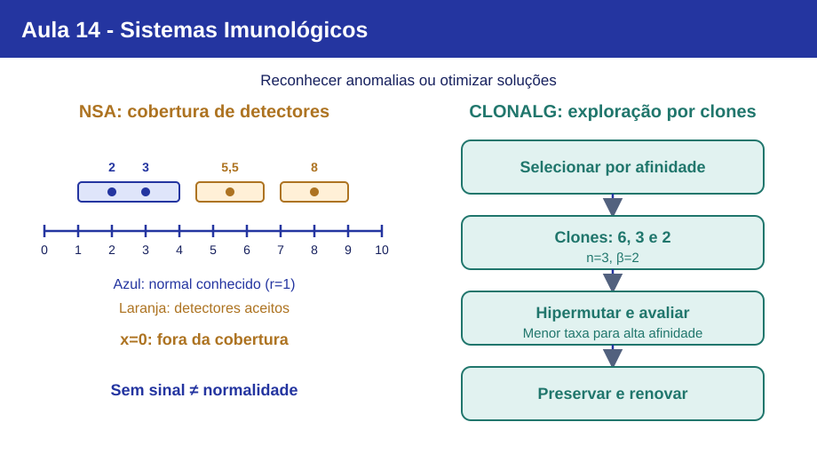
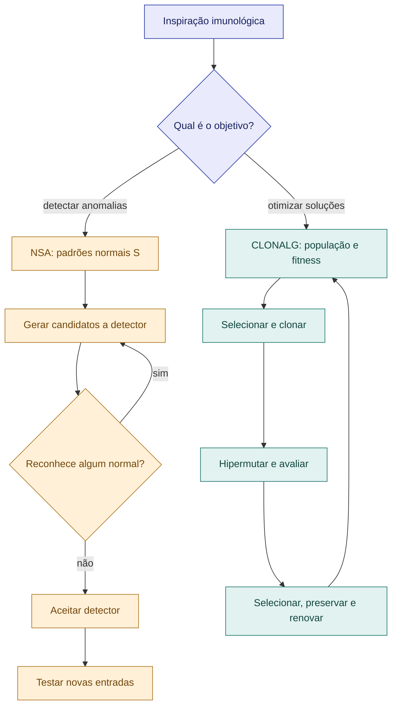

# Nota visual 14 - Sistemas Imunológicos Artificiais



**Questão central:** como reconhecer padrões desconhecidos e explorar boas soluções sem perder diversidade?

## Mapa conceitual



## Conceitos em sequência

1. **Abstração biológica:** reconhecimento, seleção, diversidade e memória inspiram algoritmos; não reproduzem integralmente o sistema imunológico.
2. **Seleção Negativa (NSA):** aprende uma coleção de detectores que não reconhecem os padrões normais conhecidos. Na aplicação, uma entrada que ativa algum detector é sinalizada como possível anomalia.
3. **Cobertura:** a escolha de distância, limiar, quantidade de detectores e amostras normais define as regiões reconhecidas. Ausência de ativação não comprova normalidade.
4. **Seleção Clonal (CLONALG):** mantém candidatos avaliados por afinidade. Seleciona soluções promissoras, cria clones e aplica hipermutação antes de reavaliar.
5. **Exploração e intensificação:** candidatos de alta afinidade podem receber mais clones e menores taxas de mutação; candidatos de menor afinidade podem sofrer perturbações maiores. Renovação ajuda a preservar diversidade.
6. **Comparação:** NSA e CLONALG têm objetivos distintos; na prática de otimização, compare CLONALG com AG, ACO e BPSO usando representação e avaliação comuns.

## NSA: duas etapas, duas decisões

| Etapa | Regra na variante de raio fixo | Resultado |
|---|---|---|
| Formação | Rejeitar candidato d se existir normal s com dist(d,s) ≤ r | Detectores tolerantes aos padrões conhecidos |
| Aplicação | Sinalizar x se existir detector d com dist(d,x) ≤ r | Possível anomalia |

No exemplo da aula, o espaço é [0,10], os padrões normais são S = {2,3} e o raio r = 1.

| Candidato | Distância ao normal mais próximo | Decisão |
|---|---:|---|
| 2,6 | 0,4 | Rejeitar |
| 5,5 | 2,5 | Aceitar |
| 8,0 | 5,0 | Aceitar |

Com D = {5,5; 8}, as regiões cobertas pelos detectores são [4,5; 6,5] e [7; 9]. O ponto 7,5 é sinalizado porque sua distância ao detector 8 é 0,5. Já o ponto 0 não é sinalizado, embora esteja distante dos padrões normais. Há regiões sem cobertura.

**Interpretação dos parâmetros:** aumentar r amplia a área reconhecida por cada detector, mas também pode dificultar a formação de detectores tolerantes ao próprio. Em muitas dimensões, cobertura e custo tornam-se especialmente relevantes. Distâncias dependem da escala dos atributos.

## CLONALG: como a qualidade orienta a busca

Afinidade é uma medida de qualidade coerente com o objetivo. Para maximização, uma normalização possível é:

```text
aᵢ = (fᵢ - fmin) / (fmax - fmin), se fmax > fmin
```

Quando todos os valores forem iguais, deve-se definir explicitamente uma política para evitar divisão por zero. Na minimização, inverta o sentido da qualidade.

Na variante apresentada na teoria, selecione n candidatos ordenados por afinidade e produza:

```text
Nᵢ = max(1, floor(β · n / i))
pₘ(a) = pmin + (pmax - pmin) · (1 - a)
```

- i é a posição no ranking (1 é o melhor); β controla a intensidade da clonagem.
- Nᵢ é a quantidade de clones do candidato i.
- a ∈ [0,1] é sua afinidade normalizada.
- pmin e pmax limitam a probabilidade de mutação por gene na variante binária.

Por exemplo, com n = 3 e β = 2, os três selecionados geram 6, 3 e 2 clones. Com pmin = 0,02 e pmax = 0,30, uma afinidade 0,8 produz pₘ = 0,076; afinidade 0,2 produz pₘ = 0,244. São probabilidades, não números garantidos de bits invertidos.

As regras são variantes didáticas, não fórmulas universais de CLONALG. A prática usa arredondamento para cima (ceil) na clonagem e afinidade fitness/16 para a imagem binária; a teoria ilustra arredondamento para baixo. Clonar mais também aumenta o custo de avaliação.

## Exemplo: seleção de itens

Capacidade C = 7; pesos (2,3,4,5), valores (3,4,5,8), nos itens A, B, C e D. Com penalização λ = 10:

```text
f(x) = Σ vᵢ xᵢ - λ · max(0, Σ wᵢ xᵢ - C)
```

| Candidato | Peso | Valor bruto | Fitness |
|---|---:|---:|---:|
| 1001 | 7 | 11 | 11 |
| 0110 | 7 | 9 | 9 |
| 1100 | 5 | 7 | 7 |
| 0011 | 9 | 13 | -7 |

Uma possível hipermutação de 1100 é 1100 → 1000 → 1001. O clone passa de fitness 7 para 11. Entretanto, uma mutação também pode piorar o candidato ou violar restrições. A seleção posterior e a preservação do melhor conhecido evitam perder a melhor solução encontrada.

## Comparação: mesmo problema, mecanismos diferentes

| Método | Informação que orienta a busca | Geração de candidatos |
|---|---|---|
| AG | Fitness dos pais | Crossover e mutação |
| ACO | Feromônios e, quando aplicável, heurística | Construção por amostragem |
| BPSO | pbest, gbest e velocidade | Atualização probabilística dos bits |
| CLONALG | Afinidade, ranking e memória | Clonagem, hipermutação e renovação |

Na imagem de 16 bits da prática, o fitness conta coincidências com o alvo. Para o Trabalho 02, preserve objetivo, restrições e representação compatível e compare pelo orçamento de avaliações, múltiplas sementes e qualidade das soluções, não apenas pelo número de gerações.

## Revisão de 30 segundos

NSA constrói detectores tolerantes aos padrões normais; CLONALG explora soluções por seleção, clonagem, hipermutação e renovação. A inspiração é compartilhada, mas os problemas resolvidos e os critérios de avaliação são diferentes.

## Erros conceituais frequentes

- Tratar ausência de ativação no NSA como prova de normalidade.
- Confundir raio do detector com afinidade de uma solução de otimização.
- Supor que a hipermutação sempre melhora o fitness.
- Aplicar operadores binários diretamente a permutações sem respeitar restrições.
- Contabilizar somente gerações, ignorando avaliações de clones e novos candidatos.
- Concluir superioridade geral a partir de uma execução.

## Revisão de 1 minuto

Explique por que o NSA rejeita um detector próximo de um padrão normal. Depois descreva como ranking, quantidade de clones, taxa de mutação e renovação afetam exploração e custo em CLONALG.

## Checklist

- [ ] Distingo detecção de anomalias e otimização.
- [ ] Aplico a regra de formação e ativação de detectores.
- [ ] Reconheço regiões sem cobertura.
- [ ] Interpreto afinidade, ranking e taxa de hipermutação.
- [ ] Calculo fitness com penalização e respeito às restrições.
- [ ] Comparo AG, ACO, BPSO e CLONALG por avaliações e sementes.

[Estudo guiado](../../estudos-guiados/14-sistemas-imunologicos/README.md) · [Slides da Aula 14](https://github.com/tiagofga/EC-IA/tree/main/aulas/14-sistemas-imunologicos) · [Código Python](https://github.com/tiagofga/EC-IA/tree/main/exemplos/14-sistemas-imunologicos)

**Próxima conexão:** enquanto as metaheurísticas combinam mecanismos de busca sobre candidatos, os métodos ensemble combinam predições de modelos de aprendizagem para melhorar a generalização.
