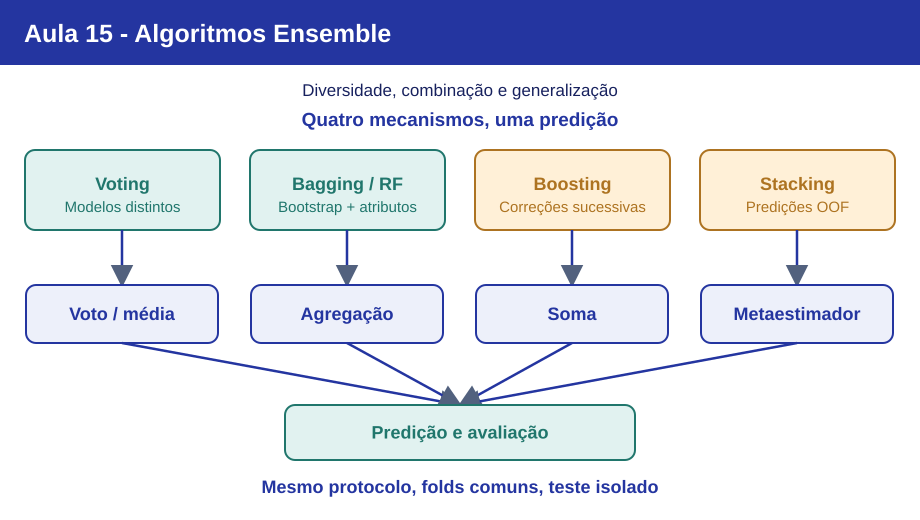
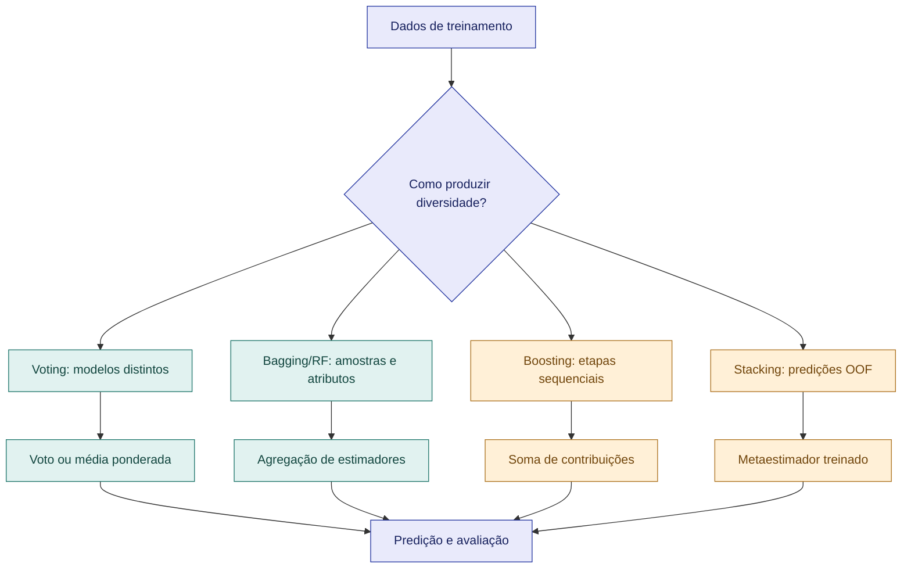
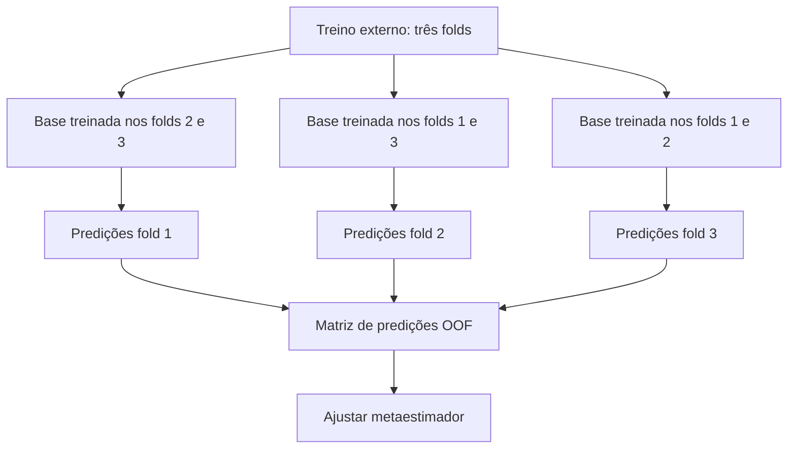

# Nota visual 15 - Algoritmos Ensemble



**Questão central:** por que combinar modelos pode melhorar a generalização e quando isso não acontece?

## Mapa conceitual



## Conceitos em sequência

1. **Modelos individuais:** DT, KNN e SVM apresentam diferentes hipóteses, sensibilidades e padrões de erro.
2. **Diversidade:** modelos que erram sempre juntos oferecem pouca vantagem ao serem combinados. Diversidade sem qualidade individual também não garante melhoria.
3. **Voting:** agrega classes ou probabilidades de estimadores ajustados separadamente.
4. **Bagging e Random Forest:** treinam estimadores sobre amostras bootstrap; Random Forest também sorteia atributos candidatos em cada divisão.
5. **Boosting:** constrói estimadores de forma sequencial, direcionando os próximos ajustes aos erros ou à perda acumulada.
6. **Stacking:** aprende a combinação com um metaestimador treinado sobre predições fora dos folds (OOF).

## Diversidade, viés e variância

Viés é o erro sistemático associado às hipóteses de um modelo. Variância descreve sua sensibilidade a mudanças nos dados de treinamento. Para M preditores numéricos com mesma variância σ² e correlação comum ρ:

```text
Var(h̄) = σ² · [ρ + (1 - ρ)/M]
```

h̄ é a média dos preditores, M é a quantidade de modelos e ρ mede a correlação entre suas saídas aleatórias. Com M = 10 e σ² = 1:

| Correlação ρ | Variância da média |
|---:|---:|
| 0 | 0,10 |
| 0,5 | 0,55 |
| 1 | 1,00 |

O ganho diminui quando os preditores são fortemente correlacionados. A equação trata a variância da média sob hipóteses específicas; não representa diretamente a acurácia de um classificador.

## Voting: votos não são probabilidades

Hard voting escolhe a classe com maior soma de votos. Soft voting escolhe a classe com maior média ponderada de probabilidades.

```text
Hard: ŷ = argmax_c Σ wₘ · 1[hₘ(x) = c]
Soft: ŷ = argmax_c (Σ wₘ · pₘ(c|x)) / Σ wₘ
```

hₘ(x) é a classe prevista pelo modelo m; pₘ(c|x) é sua probabilidade estimada para a classe c; wₘ é um peso não negativo, com soma positiva. A função indicadora vale 1 quando o modelo vota na classe c.

| Modelo | P(0) | P(1) | Voto |
|---|---:|---:|---:|
| DT | 0,49 | 0,51 | 1 |
| KNN | 0,48 | 0,52 | 1 |
| SVM | 0,95 | 0,05 | 0 |

Com pesos iguais, hard voting escolhe 1 por dois votos contra um. Soft voting escolhe 0, pois P(1) = 0,36 e P(0) = 0,64. Probabilidades precisam estar alinhadas às classes e ter qualidade de calibração adequada; empates exigem regra definida.

## Bagging e Random Forest: duas fontes de diversidade

| Procedimento | Bagging de árvores | Random Forest clássica |
|---|---|---|
| Treino de cada árvore | Amostra bootstrap | Amostra bootstrap |
| Atributos disponíveis em cada nó | Todos | Subconjunto sorteado |
| Combinação | Agregar predições | Agregar predições |

Bootstrap sorteia n exemplos com reposição a partir de n exemplos de treino. Para índices [1,2,3,4,5], uma amostra possível é [1,1,3,5,3]. Os exemplos 2 e 4 ficaram fora da amostra (out-of-bag, OOB).

```text
P(exemplo ausente) = (1 - 1/n)^n → 1/e ≈ 0,368
```

A aproximação de 36,8% vale para n grande, com n sorteios independentes e reposição. OOB usa modelos que não treinaram com aquele exemplo; não substitui automaticamente avaliação externa.

Na Random Forest, max_features controla os atributos considerados por divisão, max_depth limita complexidade e n_estimators controla a quantidade de árvores. Aumentar árvores eleva custo e pode produzir ganhos marginais.

## Boosting: corrigir o modelo em etapas

### AdaBoost binário

Com rótulos yᵢ e predições hₜ(xᵢ) em {-1,+1} e pesos normalizados wᵢ:

```text
εₜ = Σ wᵢ · 1[yᵢ ≠ hₜ(xᵢ)]
αₜ = 0,5 · ln((1 - εₜ)/εₜ)
wᵢ' ∝ wᵢ · exp(-αₜ · yᵢ · hₜ(xᵢ))
H(x) = sign(Σ αₜ · hₜ(x))
```

εₜ é o erro ponderado; αₜ representa a contribuição do estimador; os novos pesos são normalizados. No caso binário clássico, um estimador útil tem erro inferior a 0,5; erros extremos exigem tratamento próprio.

Exemplo da aula: quatro pesos iguais a 0,25 e apenas o último exemplo incorreto. Temos ε = 0,25 e α ≈ 0,5493. Após normalização:

| Exemplo | Peso inicial | Peso atualizado |
|---|---:|---:|
| 1, 2 e 3 (cada) | 0,25 | 0,1667 |
| 4 | 0,25 | 0,50 |

O exemplo incorreto ganha importância relativa. Isso pode ajudar em casos difíceis, mas também amplificar ruídos.

### Gradient Boosting

```text
Fₜ(x) = Fₜ₋₁(x) + η · hₜ(x)
```

Fₜ₋₁ é a predição acumulada, hₜ é o novo estimador ajustado à direção de redução da perda e η é a taxa de aprendizagem. Para perda quadrática, o gradiente negativo é o resíduo y - F.

| Exemplo | Real | F₀ | Resíduo | F₁ com η = 0,5 |
|---|---:|---:|---:|---:|
| A | 2 | 4 | -2 | 3 |
| B | 4 | 4 | 0 | 4 |
| C | 6 | 4 | 2 | 5 |

Se o estimador reproduz os resíduos, o MSE passa de 8/3 para 2/3 neste exemplo didático. Em classificação, a direção da correção depende da perda escolhida, como log-loss.

## Stacking: o metaestimador precisa de predições honestas



Cada coluna ou conjunto de colunas da matriz OOF corresponde às predições de um modelo base. Cada linha é produzida sem ajustar aquele modelo ao exemplo correspondente. Para inferência, os modelos base são reajustados em todo o treino; suas predições para uma nova entrada alimentam o metaestimador. O teste externo permanece isolado.

## Qual método escolher?

| Método | Principal mecanismo | Atenção |
|---|---|---|
| Voting | Regra fixa de combinação | Diversidade e calibração |
| Bagging | Reamostragem e agregação | Variância e custo |
| Random Forest | Bagging + atributos aleatórios | Complexidade e diversidade das árvores |
| AdaBoost | Reponderação de exemplos | Ruídos e erros difíceis |
| Gradient Boosting | Correção sequencial da perda | Taxa de aprendizagem e sobreajuste |
| Stacking | Combinação aprendida | Vazamento de dados e custo da validação |

## Conexão com a prática e Trabalho 02

Compare DT, KNN e SVM com os sete ensembles da prática usando os mesmos cinco folds estratificados no treino. Registre média e desvio-padrão de F1, demais métricas e tempo de treinamento. Transformações que aprendem parâmetros devem ser ajustadas dentro de cada fold. No stacking, a validação interna gera OOF somente no treino do fold externo. Preserve o teste final até que modelos e hiperparâmetros estejam definidos.

As sementes e divisões devem ser controladas; não selecione a seed que produz o melhor valor. No Trabalho 02, justifique a escolha do ensemble com evidência experimental, não apenas por sua complexidade.

## Revisão de 30 segundos

Voting combina saídas por uma regra; bagging reduz variabilidade pela reamostragem; Random Forest acrescenta diversidade de atributos; boosting corrige a perda em etapas; stacking aprende a combinação por predições OOF.

## Erros conceituais frequentes

- Confundir voting de classes com média de probabilidades.
- Afirmar que mais modelos sempre aumentam a acurácia.
- Confundir bootstrap com divisão sem reposição.
- Tratar Random Forest como simples votação de árvores idênticas.
- Interpretar qualquer boosting como reponderação de exemplos.
- Treinar o metaestimador sobre predições dos mesmos exemplos usados no ajuste dos modelos base.
- Escolher parâmetros usando o teste final.

## Revisão de 1 minuto

Explique por que hard e soft voting podem discordar. Compare a geração paralelizável de estimadores em bagging com a construção sequencial em boosting e justifique o uso de OOF no stacking.

## Checklist

- [ ] Diferencio viés, variância e diversidade.
- [ ] Interpreto ρ, σ² e M na variância da média.
- [ ] Calculo hard e soft voting.
- [ ] Identifico amostras bootstrap, OOB e atributos sorteados.
- [ ] Interpreto ε, α e os pesos de AdaBoost.
- [ ] Calculo uma atualização simples de Gradient Boosting.
- [ ] Explico stacking com OOF sem vazamento.
- [ ] Comparo modelos com as mesmas divisões e métricas.

[Estudo guiado](../../estudos-guiados/15-ensemble/README.md) · [Slides da Aula 15](https://github.com/tiagofga/EC-IA/tree/main/aulas/15-ensemble) · [Código Python](https://github.com/tiagofga/EC-IA/tree/main/exemplos/15-ensemble)

**Próxima conexão:** consolidar os resultados da aprendizagem supervisionada e da computação natural no Trabalho 02, respeitando as diferenças entre avaliação de modelos e otimização de soluções.
